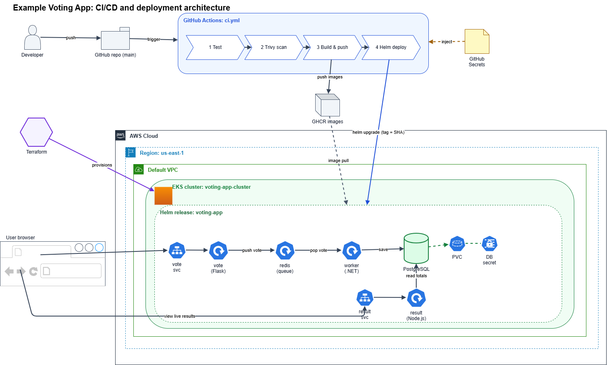
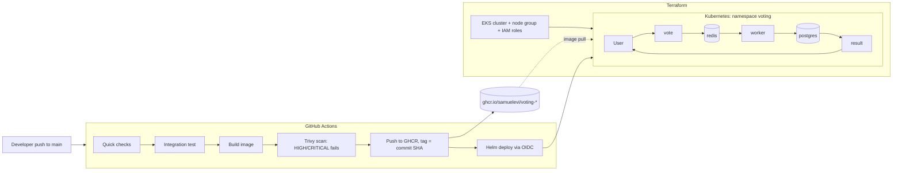

# Voting App: DevOps Capstone 1 ("Ship It")

A fork of `dockersamples/example-voting-app`, taken from source code to an automated, scanned, containerised deployment.

- **Containers:** hardened Dockerfiles (pinned bases, non-root, `.dockerignore`)
- **Infrastructure as code:** Terraform builds an EKS cluster in the default VPC
- **CI:** GitHub Actions runs checks, an end-to-end test, a build, a Trivy scan and a push, tagged with the commit SHA
- **Deploy:** one Helm chart, one values file, with a demonstrated rollback

## Status (update before submitting)

| Requirement | Status |
|---|---|
| App runs locally with Docker Compose | Done |
| Images hardened (pinned, non-root, `.dockerignore`) | Done |
| CI: test, Trivy scan, build, push (tag = commit SHA) | Done, all jobs green |
| Helm chart deployed, bad release shipped, `helm rollback` shown | Done on local Kubernetes (Docker Desktop) |
| No secrets in Git | Done (see Security) |
| Terraform code for EKS | Written and planned (8 resources) |
| EKS cluster created from Terraform | **Blocked:** AWS Free plan account has a 0 vCPU quota for standard instances. Update this row when resolved. |
| Deploy to EKS from CI | Written, switched off until a cluster exists |
| Destroy and rebuild from code on EKS | Pending the row above |

## Architecture




Data flow: a vote is posted to **vote**, queued in **Redis**, saved to **PostgreSQL** by the **worker**, and read by **result**.

## Repository layout

| Path | Purpose |
|---|---|
| `vote/`, `result/`, `worker/` | The three services and their Dockerfiles |
| `docker-compose.yml` | Local development (dev stages, bind mounts, nodemon) |
| `result/docker-compose.test.yml`, `result/tests/` | End-to-end test (vote, then check the result page) |
| `.github/workflows/ci.yml` | The pipeline |
| `terraform/` | EKS cluster, node group, IAM roles, GitHub OIDC deploy role |
| `helm/voting-app/` | The Helm chart and `values.yaml` |
| `scripts/bootstrap-cluster.ps1` | One-time namespace and database Secret setup after a cluster is created |

## Run it locally

Requires Docker Desktop.

```powershell
docker compose up --build
```

Vote at http://localhost:8080 and watch http://localhost:8081.

Run the end-to-end test (always finish with `down -v` so no old votes remain):

```powershell
docker compose -f result/docker-compose.test.yml up --build --abort-on-container-exit --exit-code-from sut
docker compose -f result/docker-compose.test.yml down -v
```

## Container hardening

| Control | How |
|---|---|
| Pinned base images | `python:3.11.17-slim`, `node:24.22.1-slim`, `dotnet/runtime:10.0.13`. Pinning makes builds reproducible, so bases must be refreshed on purpose. |
| Non-root | vote and worker run as UID 10001, result as `node` (UID 1000). Kubernetes uses numeric `runAsUser` values. |
| Unprivileged ports | vote and result listen on 8080 so they never need root to bind. |
| Small images | `.dockerignore` files; result and vote have separate `dev` and `final` stages; the production result image contains no npm, corepack or nodemon; setuptools is removed from vote. |
| Probes and limits | Readiness and liveness probes, CPU/memory requests and memory limits in the chart. |

## CI/CD pipeline

On every push to `main` (and weekly on a schedule, to catch newly published CVEs):

1. **Quick checks:** Python syntax check.
2. **Integration test:** the full stack runs in Docker Compose and a vote must appear on the result page.
3. **Build** each image locally on the runner (target `final` for vote and result).
4. **Trivy scan:** fails the pipeline on any fixable HIGH or CRITICAL finding, before anything is published.
5. **Push** to GitHub Container Registry, tagged with the full commit SHA (`ghcr.io/samuelevi/voting-{vote,result,worker}:<sha>`).
6. **Deploy** (disabled until a cluster exists): `helm upgrade --install` with that SHA, using GitHub's OIDC login to AWS.

Pull requests build and scan but never push.

### Decisions made while fixing scan findings

| Finding | Decision |
|---|---|
| End-of-life Node 18 and .NET 7 bases | Upgraded to Node 24 and .NET 10 |
| Vulnerable libraries in the worker (Npgsql, System.Drawing.Common) | Updated to patched versions |
| npm and nodemon bundled libraries flagged in the result image | Not shipped in the production image |
| setuptools vendored libraries in vote | setuptools removed from the runtime image |

No findings are currently accepted as risks (no `.trivyignore`).

## Infrastructure (Terraform)

Region `eu-west-1`, Kubernetes 1.34, two `m7i-flex.large` nodes, default VPC.

```powershell
cd terraform
terraform init
terraform plan
terraform apply      # about 10 to 15 minutes; billing starts here
..\scripts\bootstrap-cluster.ps1
terraform destroy    # when finished; billing stops
```

**Cost:** the EKS control plane and the nodes bill hourly while the cluster exists. Destroy it when not working.

## Deploy and roll back with Helm

```powershell
helm upgrade --install voting helm/voting-app -n voting --set image.tag=<commit-sha> --wait --timeout 3m
```

Rollback demonstration (a bad tag stands in for a bad release):

```powershell
helm upgrade voting helm/voting-app -n voting --set image.tag=does-not-exist --wait --timeout 60s   # fails
kubectl -n voting get pods        # old pods still serving, new pods ImagePullBackOff
helm history voting -n voting     # revision marked failed
helm rollback voting 1 -n voting --wait
```

Old pods keep serving traffic during the bad release because Kubernetes only retires them after the new pods pass their readiness probes.

## Security

- **No secrets in Git.** `result` and `worker` read `POSTGRES_USER` and `POSTGRES_PASSWORD` from the environment and refuse to start without them. In Kubernetes the values come from a Secret created at deploy time with a generated password (`scripts/bootstrap-cluster.ps1`); the chart references the Secret by name only. The `POSTGRES_PASSWORD: postgres` values in the Compose files are the default for a throwaway local database and are not used in Kubernetes.
- **No stored cloud credentials.** CI authenticates to AWS with GitHub OIDC and a role limited to this repository's `main` branch. That role can read the cluster description and edit resources in the `voting` namespace only.
- **Registry credentials.** CI pushes with the per-run `GITHUB_TOKEN`; nothing is stored. The three images are public so the cluster can pull without credentials, and contain no secrets.
- **Scanning before publishing.** Images that fail the Trivy gate are never pushed.

## Known limitations (deliberate trade-offs)

- PostgreSQL uses an `emptyDir` volume, so votes are lost if the database pod restarts. A persistent volume needs the EBS CSI driver add-on, which is not installed.
- The EKS API endpoint is public (still requires AWS credentials) and nodes run in the default VPC's public subnets. A production cluster would use private subnets with a NAT gateway.
- Redis and PostgreSQL use the upstream images (`redis:alpine`, `postgres:15-alpine`); they are not pinned to exact versions yet and are not scanned by this pipeline.
- The end-to-end test uses an old PhantomJS-based test image. It is test-only and never shipped.
- Vote and result are reached with `kubectl port-forward`; no load balancer or ingress is created, to avoid extra cost.
 